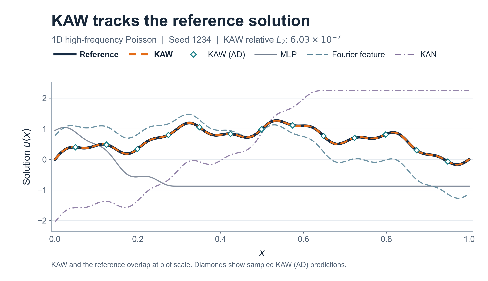

# KAW

Initial release of the one-dimensional high-frequency Poisson training example and selected figures for KAW-PINN.

**Release status:** This repository currently contains the standalone 1D training example and its model dependencies. Additional code will be added in a future update as the paper progresses.

## Problem

The example solves `-u''(x) = f(x)` on `[0, 1]` with homogeneous Dirichlet boundary conditions and the manufactured solution

```text
u(x) = sin(pi*x) + 0.25*sin(8*pi*x) + 0.10*sin(20*pi*x).
```

The 1D KAW model uses 24 sine modes and evaluates the second derivative analytically. The script also provides MLP, Fourier-feature, KAN, and automatic-differentiation baselines.

## Installation

Use Python 3.12. Install a PyTorch build suitable for your CPU or CUDA environment, together with the remaining dependencies:

```bash
python -m pip install -r requirements.txt
```

## Run

Run these commands from the repository root:

```bash
# KAW-PINN: 1200 Adam epochs followed by L-BFGS (default settings).
python -m KAW_PINN.one_dimensional.kaw_pinn_1d_high_frequency_poisson --models KAW-PINN --out-dir results/poisson_1d

# Run all five models using the standalone script's settings.
python -m KAW_PINN.one_dimensional.kaw_pinn_1d_high_frequency_poisson --out-dir results/all_models

# Short execution check; this is not a full experiment.
python -m KAW_PINN.one_dimensional.kaw_pinn_1d_high_frequency_poisson --models KAW-PINN --adam-epochs 2 --lbfgs-steps 1 --n-domain 32 --out-dir results/smoke
```

Outputs include `metrics.json` and solution/error/loss plots in PNG and PDF. The script selects CUDA when available and otherwise uses CPU.

## Selected figures

These figures are from previously archived experiments; they are not outputs of the short execution check above.

| Figure | Description |
| --- | --- |
| [Prediction](figures/01_prediction.png) | Reconstruction on a common 4097-point grid using archived seed-1234 checkpoints. |
| [Spectrum](figures/02_spectrum.png) | Absolute sine-basis coefficients; the reference has nonzero coefficients at modes 1, 8, and 20. |
| [Training loss](figures/03_convergence_loss.png) | Five archived seeds, 1234–1238; median and full seed range, without smoothing. Training loss is not test error. |
| [Frequency learning](figures/04_convergence_modes.png) | Separate hard-boundary mechanism experiment; relative errors for modes 8 and 20 at saved Adam checkpoints. |

The standalone script uses seed 2026, an evenly spaced training grid, and its own baseline configurations. The archived figures use the separate multi-seed benchmark and mechanism-study configurations. Running this initial release does not reproduce those figures exactly. The full experiment drivers and figure-reproduction workflow are planned for a later release.



## 发布说明

本次先公开一维高频 Poisson 的独立训练示例、必要模型依赖和四张已有图片。其余代码随论文后续进展补充。

当前脚本与图片来源实验的种子、采样和基线配置存在差异；图片保留历史实验结果，不代表本次短程检查的训练结果。
